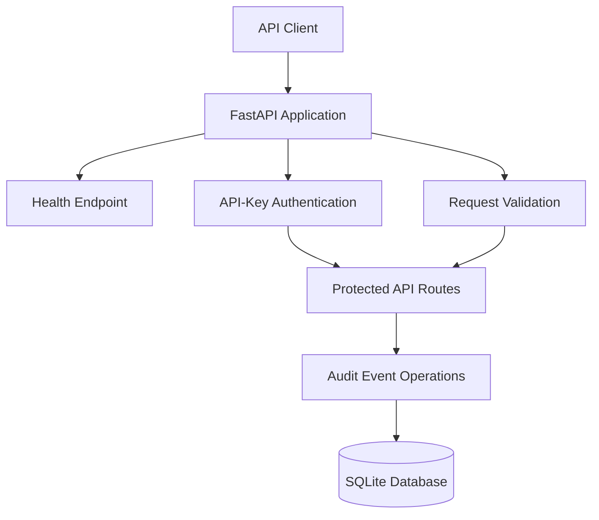
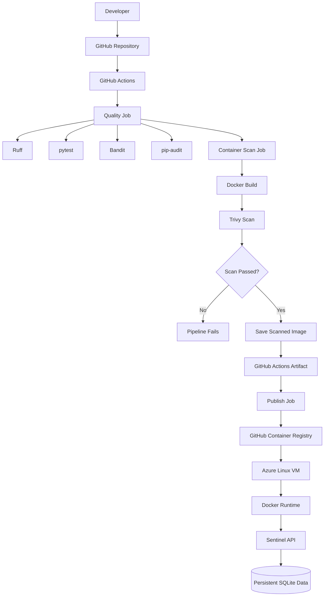

# Sentinel API

### Engineering a Secure, Traceable Application Delivery Pipeline

**#!Shebang everyone. Welcome to Sentinel API.**

A successful deployment is not necessarily a trustworthy deployment.

An application can pass its tests and still contain vulnerable dependencies. A container can run perfectly while retaining unnecessary privileges. A pipeline can scan an image successfully, only to publish a different image afterwards.

These are the problems I wanted to address with Sentinel API.

Sentinel API is a security audit-event REST service built with FastAPI and SQLite. However, the application is only one part of the project. The larger engineering exercise was designing the delivery system around it: automated validation, vulnerability scanning, container hardening, artifact traceability and deployment to Microsoft Azure.

This repository documents not just what I built, but **why I built it that way, the decisions behind the architecture, the challenges I encountered and what I learned along the way.**

If you're here to understand the engineering, you're in the right place.

---

## Project at a glance

| Area | Implementation |
|---|---|
| Application | Python 3.14, FastAPI |
| Persistence | SQLite |
| Containerization | Docker |
| CI/CD | GitHub Actions |
| Code quality | Ruff |
| Testing | pytest |
| Static security analysis | Bandit |
| Dependency auditing | pip-audit |
| Container scanning | Trivy |
| Container registry | GitHub Container Registry |
| Cloud platform | Microsoft Azure |
| Deployment OS | Ubuntu Server 24.04 LTS |

**Project repository:** [OpsByNiyko/Secure-API-Pipeline](https://github.com/OpsByNiyko/Secure-API-Pipeline)

**Project scope:** Application development → security controls → containerization → CI/CD → image publishing → Azure deployment.

---

# 01. The problem I wanted to solve

I started with three questions.

**1. Can I trust what I'm deploying?**

Passing tests establishes that the application behaves as expected under the tested conditions. It doesn't establish that its dependencies or operating-system packages are free from known vulnerabilities.

**2. Can I control how the application runs?**

A container should not automatically receive more privileges or filesystem access than its workload requires. I wanted to make the runtime environment restrictive by design.

**3. Am I deploying the exact artifact I verified?**

This was particularly important. If a pipeline builds and scans an image, then independently rebuilds it during publishing, the resulting image may not be identical.

I wanted the security assessment to apply to the artifact that actually gets published.

These questions shaped the project.

The API itself was intentionally kept small. I didn't want application complexity to distract from the engineering work surrounding its delivery.

The goal was to build a system in which quality checks, security controls and artifact handling were deliberate parts of the delivery process.

---

# 02. Understanding the architecture

Before getting into individual implementation decisions, here's how the components work together.

### Application architecture



The application exposes a small set of endpoints for creating and retrieving audit events.

The health endpoint is public. Operations involving audit data require API-key authentication.

### Delivery architecture



The important relationship is between scanning and publishing.

The pipeline saves the image that passed Trivy and transfers it to the publishing job. The publishing job loads that artifact rather than rebuilding the application image.

This is an intentional design decision, not merely a pipeline implementation detail.

---

# 03. How the system came together

I approached Sentinel API in stages. Each stage introduced a capability that the next stage could build upon.

### Stage 1 — Establishing the application

I started with FastAPI and established the API structure, request handling and health endpoint.

The objective was to keep the service small and provide a functional foundation for the rest of the project.

### Stage 2 — Introducing persistence

SQLite became the persistence layer for audit events.

I implemented database initialization, event creation and retrieval. SQL statements use parameterized values rather than constructing queries through string interpolation.

The database choice was intentional: the workload was small enough that introducing a separate database service would add operational complexity without providing a necessary benefit.

### Stage 3 — Controlling access

I introduced API-key authentication for protected endpoints.

The application reads the expected key from configuration and compares supplied keys using constant-time comparison.

The health endpoint remains unauthenticated so that the container health check can reach it without requiring application credentials.

### Stage 4 — Application-level controls

I introduced additional request and response controls:

- Pydantic request validation.
- A 16 KiB request-body limit.
- Security response headers.
- Controlled handling of unexpected application errors.
- Environment-based configuration.
- Parameterized database operations.

The intention was to establish application-level controls before moving into container and infrastructure hardening.

### Stage 5 — Containerization

I packaged the service using the `python:3.14-slim` base image.

The Docker image creates a dedicated system user, installs the required dependencies, checks dependency consistency and runs the application as a non-root user.

I also added a Docker health check against `/health`.

Container hardening continues at runtime, where filesystem permissions, Linux capabilities and resource consumption can be restricted further.

### Stage 6 — CI/CD and automated validation

I introduced GitHub Actions to automate code-quality checks, tests, dependency auditing, static security analysis and container vulnerability scanning.

The pipeline was divided into three jobs:

1. Quality and security checks.
2. Docker build and Trivy scan.
3. Publishing the scanned image to GHCR.

This stage also introduced one of the project's most interesting troubleshooting challenges: the Trivy/SBOM issue discussed later in this walkthrough.

### Stage 7 — Azure deployment

The final defined stage involved deploying the published image to an Ubuntu virtual machine on Azure.

I provisioned the networking and compute environment, installed Docker Engine, pulled the image from GHCR and configured the container with persistent storage and restrictive runtime settings.

The deployment remained private, with application access provided through an SSH tunnel.

---

# 04. The application: keeping the workload intentional

Sentinel API is an audit-event management service.

Its responsibility is straightforward: accept validated audit events and make them available for retrieval.

### API endpoints

| Method | Endpoint | Authentication | Purpose |
|---|---|---|---|
| GET | `/health` | Public | Check application availability |
| POST | `/events` | Required | Create an audit event |
| GET | `/events` | Required | Retrieve audit events |
| GET | `/events/{event_id}` | Required | Retrieve an individual event |

### Audit event model

An event contains:

| Field | Description |
|---|---|
| `id` | Automatically generated identifier |
| `event_type` | Event classification |
| `actor` | Entity associated with the event |
| `description` | Event description |
| `severity` | Event severity |
| `created_at` | UTC creation timestamp |

The accepted severity values are `info`, `warning` and `critical`.

The request model also applies length restrictions and validates the event-type format. Additional fields are rejected rather than silently accepted.

### Example request

```http
POST /events
Content-Type: application/json
X-API-Key: YOUR_API_KEY
```

```json
{
  "event_type": "user.login",
  "actor": "system-user",
  "description": "User successfully authenticated",
  "severity": "info"
}
```

### Example response

```json
{
  "id": 1,
  "event_type": "user.login",
  "actor": "system-user",
  "description": "User successfully authenticated",
  "severity": "info",
  "created_at": "2026-01-01T12:00:00+00:00"
}
```

The timestamp above illustrates the response format; actual values are generated when events are created.

### Retrieval behaviour

The event listing endpoint supports a `limit` query parameter between 1 and 100, defaulting to 100.

For example:

```bash
curl -H "X-API-Key: $API_KEY" \
  "http://127.0.0.1:8000/events?limit=20"
```

Retrieving an event that doesn't exist returns HTTP 404.

The application also returns HTTP 401 when the API key is missing or invalid.

---

# 05. Engineering decisions: why I chose this architecture

This is where the project becomes more interesting than a conventional application deployment.

The technologies matter, but the reasoning behind their selection matters more.

## Why SQLite instead of PostgreSQL?

I considered the workload before choosing the database.

Sentinel API records audit events and supports basic retrieval. For this project's scope, SQLite provided persistence without requiring another service to provision, secure, monitor and maintain.

That decision has a trade-off.

SQLite uses a single-writer model. A workload with substantial concurrent writes would eventually require a different persistence architecture.

For a larger deployment, I'd evaluate managed PostgreSQL, including its backup, availability and recovery requirements.

The lesson: choosing a technology should follow the workload, not the popularity of the technology.

## Why GitHub Actions?

The source code and delivery workflow already lived in GitHub.

GitHub Actions allowed me to define the pipeline alongside the application, enforce checks on pushes and pull requests, and transfer artifacts between jobs.

It also provided a straightforward way to authenticate to GHCR using the workflow's `GITHUB_TOKEN`.

I didn't need to introduce a separate CI platform for this project.

## Why pip-audit and Trivy?

They inspect different parts of the delivery chain.

`pip-audit` checks the Python dependencies against known vulnerability advisories.

Trivy scans the built container image, including operating-system packages and application libraries within its configured scan scope.

One does not replace the other.

I wanted dependency auditing before packaging and image scanning after packaging.

## Why scan once and publish the same image?

A container image is a build artifact.

If the publishing job builds the image again, the new build could differ from the scanned one because of changes in base-image contents or package repositories.

Instead, the scan job saves the image as a workflow artifact. The publish job downloads and loads that exact artifact.

This gives the pipeline a stronger relationship between what was assessed and what was published.

## Why a non-root container user?

The application doesn't require root privileges to serve HTTP requests or write to its designated data directory.

The Dockerfile creates a dedicated user and assigns ownership of the application directory accordingly.

Running with reduced privileges limits the permissions available to the process.

## Why a read-only root filesystem?

The application should not need unrestricted filesystem writes during normal operation.

At runtime, I use a read-only root filesystem and provide a temporary writable `/tmp` filesystem.

The SQLite database is mounted separately from the host.

This separates temporary application activity from persistent application data.

## Why localhost-only access?

The project did not require public access to the API.

The container port is published to the VM's loopback interface:

```text
127.0.0.1:8000
```

I can access it through SSH port forwarding without exposing the application port directly to external clients.

This was a deliberate deployment boundary, not an unfinished public deployment.

---

# 06. CI/CD: establishing the delivery gates

The workflow lives at:

```text
.github/workflows/ci.yml
```

It runs on pushes and pull requests targeting `main`, and also supports manual execution.

The workflow has three jobs.

## Job 1 — Quality and security checks

The first job establishes whether the application is ready to proceed.

| Tool | What it checks |
|---|---|
| Ruff | Linting and formatting |
| pytest | Automated tests |
| Bandit | Python security findings |
| pip-audit | Known vulnerabilities in Python dependencies |

The commands include:

```bash
ruff check .
ruff format --check .
pytest -v
bandit -r app -ll
pip-audit -r requirements.txt
```

The pipeline uses Python 3.14 and installs the development dependencies from `requirements-dev.txt`.

A failure in this job prevents the dependent container scan job from proceeding.

## Job 2 — Container build and vulnerability scan

Once the quality job succeeds, the pipeline builds the Docker image.

The image is tagged with the Git commit SHA.

Trivy then scans the image using the following policy:

```yaml
format: table
exit-code: "1"
ignore-unfixed: true
vuln-type: os,library
severity: HIGH,CRITICAL
```

The scan is intended to stop publication when qualifying HIGH or CRITICAL vulnerabilities are detected.

The image is saved and uploaded as an artifact on pushes to `main`, after the scan succeeds.

## Job 3 — Publish to GHCR

The publishing job runs only for pushes to `main`, and only after the quality and container-scan jobs succeed.

It downloads the saved image artifact, loads it into Docker and authenticates to GitHub Container Registry.

The image receives two tags:

```text
sha-<commit-sha>
latest
```

The commit-specific tag is important because it identifies the source revision associated with the image.

The `latest` tag is convenient, but mutable. For deployment and traceability, I prefer the commit-specific tag.

**The result:** an automated delivery pipeline that validates the application, scans the built image and publishes the artifact that passed the configured scan.

---

# 07. The challenge: when Trivy kept reporting the wrong setuptools version

This was one of the most valuable troubleshooting exercises in the project.

The container scan repeatedly failed with a HIGH-severity finding:

```text
CVE-2025-47273
Package: setuptools
Detected version: 70.3.0
```

The unexpected part was that the Dockerfile already upgraded setuptools.

The installed version I expected was:

```text
setuptools 84.2.1
```

So why was Trivy reporting an older version?

## Investigating the discrepancy

I didn't want to solve this by blindly suppressing the vulnerability.

First, I inspected the actual built container.

The investigation confirmed:

- The installed setuptools version was `84.2.1`.
- Only one setuptools distribution metadata directory was present.
- Python reported the expected installed version.
- The vulnerable version was not the active installed setuptools distribution.

That changed the direction of the investigation.

The scanner was finding package information somewhere other than the installed distribution metadata.

Further inspection identified an outdated setuptools component entry inside pip's embedded CycloneDX SBOM:

```text
pip/_vendor/bom.cdx.json
```

The stale entry was being interpreted as a component during image scanning.

The important distinction was between the package actually installed in the container and the older package version referenced by embedded metadata.

## Choosing a correction

There were several possible approaches.

| Proposed approach | Decision |
|---|---|
| Ignore the CVE globally | Rejected |
| Lower the vulnerability severity threshold | Rejected |
| Disable Trivy | Rejected |
| Exclude all SBOM files | Rejected |
| Exclude the specific stale metadata file | Implemented |

The correction was deliberately narrow.

I added the following exclusion to the Trivy scan configuration:

```yaml
skip-files: "**/pip/_vendor/bom.cdx.json"
```

The HIGH/CRITICAL severity policy and failing exit code remained unchanged:

```yaml
severity: HIGH,CRITICAL
exit-code: "1"
```

This avoided weakening the entire vulnerability gate to address one misleading metadata entry.

## What changed?

The pipeline could proceed without the stale embedded SBOM entry generating the same misleading setuptools finding.

More importantly, the actual installed package version had already been verified independently.

I did not interpret this as proof that the entire image was vulnerability-free. The exclusion only removes that particular file from the scan input. Other components remain subject to the configured scan.

## The engineering lesson

A security scanner is only as useful as the evidence it analyzes and the interpretation applied to its findings.

A failed scan should trigger investigation.

It should not automatically trigger a global exception, a lower severity threshold or the removal of the security control.

**The goal is not to make the pipeline green at any cost. The goal is to understand what failed and correct the underlying problem without compromising the integrity of the process.**

---

# 08. Container hardening: reducing runtime privileges

The Docker image is built from:

```dockerfile
FROM python:3.14-slim
```

The Dockerfile also:

- Configures Python runtime behaviour.
- Updates the selected operating-system package.
- Creates a dedicated `sentinel` group and user.
- Installs the required Python dependencies.
- Runs `pip check`.
- Copies application files with the correct ownership.
- Switches to the non-root user.
- Defines the container health check.

The container runs as the dedicated user rather than root.

### Runtime restrictions

The Azure deployment adds further restrictions:

| Docker option | Purpose |
|---|---|
| `--read-only` | Makes the container root filesystem read-only |
| `--tmpfs /tmp` | Provides temporary writable storage |
| `--cap-drop ALL` | Drops Linux capabilities |
| `--security-opt no-new-privileges:true` | Prevents privilege escalation through exec |
| `--pids-limit 100` | Restricts process creation |
| `--memory 384m` | Sets the memory limit |
| `--cpus 0.75` | Restricts CPU allocation |

These controls are applied at runtime because image construction and container execution address different security concerns.

A container can be built securely and still be run with unnecessarily broad permissions. I wanted the deployment configuration to account for that.

---

# 09. Deploying the application on Microsoft Azure

The final stage moved Sentinel API from the CI/CD pipeline into a cloud-hosted environment.

I chose Azure for this deployment and used a Linux virtual machine to retain control over the networking and Docker runtime.

### Infrastructure configuration

| Component | Configuration |
|---|---|
| Cloud provider | Microsoft Azure |
| Region | South Africa North |
| Resource group | `rg-sentinel-api` |
| Virtual network | `vnet-sentinel` |
| VNet address space | `10.20.0.0/16` |
| Subnet | `snet-app` |
| Subnet address range | `10.20.1.0/24` |
| Network Security Group | `nsg-sentinel` |
| Virtual machine | `vm-sentinel-api` |
| VM size | Standard_B1s |
| Operating system | Ubuntu Server 24.04 LTS |
| OS disk | 30 GiB Standard HDD |
| Disk SKU | Standard_LRS |

SSH access was restricted using the Network Security Group.

The application itself was not exposed through a public application listener.

## Deploying the published image

The VM retrieves the image from GHCR.

The deployment uses the commit-specific image tag rather than relying on `latest`.

```bash
docker pull ghcr.io/opsbyniyko/secure-api-pipeline:sha-<commit-sha>
```

The VM does not rebuild the application. The image was already built, scanned and published by the pipeline.

## Persistent storage

The database is stored outside the container:

```text
/opt/sentinel-api/data
```

The directory is mounted into:

```text
/app/data
```

This is important because container replacement should not automatically destroy application data.

The database path is configured through the environment file:

```text
/etc/sentinel-api/sentinel.env
```

The environment file is kept outside the image and supplied at container startup.

## Running the container

The deployment uses the following runtime configuration:

```bash
docker run -d \
  --name sentinel-api \
  --restart unless-stopped \
  --publish 127.0.0.1:8000:8000 \
  --env-file /etc/sentinel-api/sentinel.env \
  --volume /opt/sentinel-api/data:/app/data \
  --read-only \
  --tmpfs /tmp \
  --cap-drop ALL \
  --security-opt no-new-privileges:true \
  --pids-limit 100 \
  --memory 384m \
  --cpus 0.75 \
  ghcr.io/opsbyniyko/secure-api-pipeline:sha-<commit-sha>
```

The host data directory must be writable by the container's application user.

The port mapping is intentionally bound to `127.0.0.1`.

## Accessing the API

I use an SSH tunnel to access the private application from my local machine:

```bash
ssh -L 8000:127.0.0.1:8000 \
  sentineladmin@<VM_PUBLIC_IP>
```

Then:

```bash
curl http://127.0.0.1:8000/health
```

Protected endpoints can be tested using the API key.

### Why no public domain?

The deployment objective was to validate the delivery process and operate the application on Azure.

Public exposure, a custom domain, reverse proxy and HTTPS termination were not requirements.

The private deployment was intentional.

---

# 10. Operational verification

A deployment is not complete simply because `docker run` returns successfully.

I use the following commands to inspect the running service.

### Container status

```bash
docker ps
```

### Application logs

```bash
docker logs sentinel-api
```

### Resource consumption

```bash
docker stats sentinel-api --no-stream
```

### Container health

```bash
docker inspect \
  --format='{{.State.Health.Status}}' \
  sentinel-api
```

### Application health

```bash
curl http://127.0.0.1:8000/health
```

### Persistence verification

A useful persistence test is to:

1. Create an audit event.
2. Confirm that it can be retrieved.
3. Replace the application container.
4. Retrieve the event again.

If the event remains available, the host-mounted database directory is doing its job.

The container restart policy also provides a mechanism for restarting the application after a container failure or VM restart.

---

# 11. Repository structure

```text
Secure-API-Pipeline/
│
├── .github/
│   └── workflows/
│       └── ci.yml
│
├── app/
│   ├── main.py
│   ├── config.py
│   ├── database.py
│   ├── middleware.py
│   ├── security.py
│   │
│   └── schemas/
│       └── audit.py
│
├── tests/
│
├── .dockerignore
├── .env.example
├── .gitignore
├── Dockerfile
├── pyproject.toml
├── requirements.txt
├── requirements-dev.txt
└── README.md
```

Each part has a defined responsibility:

- `app/` contains the application and its supporting modules.
- `tests/` contains automated tests.
- `.github/workflows/ci.yml` defines the delivery pipeline.
- `Dockerfile` defines the container image.
- `requirements.txt` defines runtime dependencies.
- `requirements-dev.txt` includes the development and validation tools.
- `.env.example` provides a configuration template without real credentials.
- `pyproject.toml` contains tool configuration.

---

# 12. Running Sentinel API locally

You don't need Azure to run the application or explore its endpoints.

### Prerequisites

- Python 3.14
- Git
- Docker (optional for local Python execution)

### Clone the repository

```bash
git clone https://github.com/OpsByNiyko/Secure-API-Pipeline.git

cd Secure-API-Pipeline
```

### Create a virtual environment

Linux/macOS:

```bash
python3 -m venv .venv

source .venv/bin/activate
```

Windows PowerShell:

```powershell
python -m venv .venv

.venv\Scripts\Activate.ps1
```

### Install dependencies

```bash
python -m pip install --upgrade pip

pip install -r requirements-dev.txt
```

### Configure the application

```bash
cp .env.example .env
```

Set your own API key in `.env`.

Do not commit real credentials or production environment files.

### Start the API

```bash
uvicorn app.main:app --reload
```

The service is available at:

```text
http://127.0.0.1:8000
```

### Run the validation tools

```bash
ruff check .
ruff format --check .

pytest -v

bandit -r app -ll

pip-audit -r requirements.txt
```

### Build the Docker image

```bash
docker build -t sentinel-api:local .
```

### Run the Docker container

```bash
docker run -d \
  --name sentinel-api \
  --publish 127.0.0.1:8000:8000 \
  --env-file .env \
  sentinel-api:local
```

This is a basic local container run. The Azure deployment uses the additional runtime restrictions and persistent storage configuration described earlier.

---

# 13. Limitations and future engineering work

I believe a good engineering walkthrough should be honest about what a system does not provide.

Sentinel API demonstrates a complete delivery path, but it is not a highly available production platform.

There are several areas I would develop further.

| Current limitation | Possible improvement | Engineering objective |
|---|---|---|
| Manual deployment to the VM | Automated deployment and rollback | Repeatable releases |
| Infrastructure provisioned manually | Terraform or Bicep | Reproducible infrastructure |
| Environment file on the VM | Azure Key Vault | Centralized secret management |
| Single VM | Highly available infrastructure | Reduce single points of failure |
| SQLite on local disk | Managed PostgreSQL | Improved concurrency and managed recovery |
| No automated database backup | Backup and restore automation | Data recovery |
| Limited operational visibility | Centralized metrics and logging | Better incident investigation |
| Mutable `latest` tag | Digest-based deployment and image signing | Stronger artifact verification |

These are potential extensions, not requirements that were left unfinished in the defined project scope.

The next iteration should be driven by an architectural requirement rather than by adding tools for the sake of adding them.

---

# 14. What this project taught me

Sentinel API reinforced a few engineering principles that I intend to carry into future projects.

**Automation needs meaningful gates.**

A pipeline that only builds an image is not the same as a pipeline that validates the application, audits dependencies and assesses the resulting container.

**Security findings need context.**

The Trivy incident reminded me that scanner output must be investigated. A finding is a starting point for analysis, not a substitute for it.

**Artifacts deserve traceability.**

The same image should be carried from scanning to publishing. Rebuilding an artifact after verification introduces unnecessary uncertainty.

**Infrastructure decisions should follow the workload.**

SQLite was appropriate for the scope of this service. A different workload would justify a different persistence architecture.

**Operational restrictions should be intentional.**

Non-root execution, read-only filesystems, restricted capabilities and resource limits all serve a purpose. They are not decorative Docker flags.

**Deployment boundaries are architectural decisions.**

A service does not have to be publicly exposed to demonstrate a successful cloud deployment.

---

# Closing thoughts

Sentinel API started as a small application, but the real engineering exercise was everything surrounding it.

I wanted to understand what happens between writing application code and having something running on infrastructure that I can inspect, validate and operate.

That meant making decisions, encountering problems, investigating failures and occasionally discovering that the first explanation wasn't the correct one.

The Trivy/SBOM issue was a good example. The easiest response would have been to weaken the pipeline. The more useful response was to investigate the image, understand the metadata and correct the specific source of the misleading finding.

That's the approach I want to bring into every system I build.

I don't want to collect technologies. I want to understand the systems they create, the problems they solve and the trade-offs they introduce.

**This is Sentinel API. Built with intent. Engineered with purpose.**

---

**Built by OpsByNyiko**

And project complete #!Shebang
